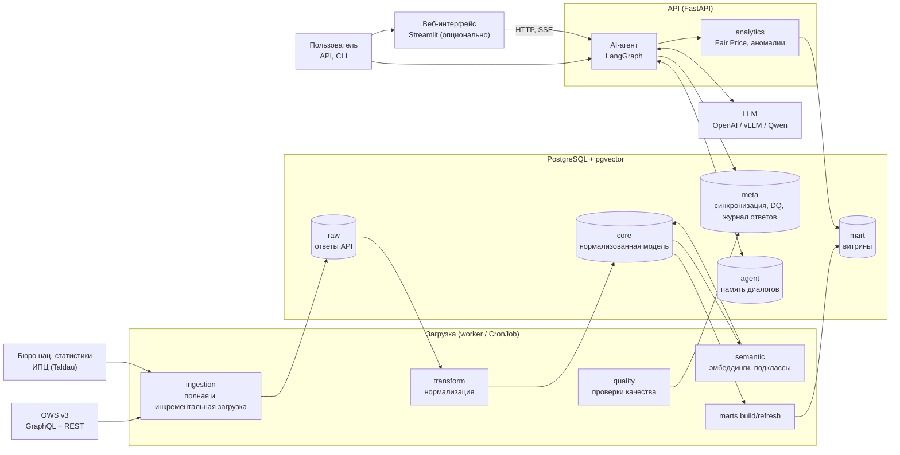
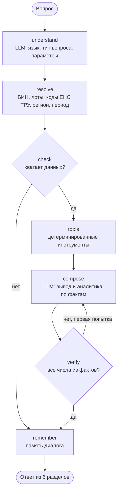
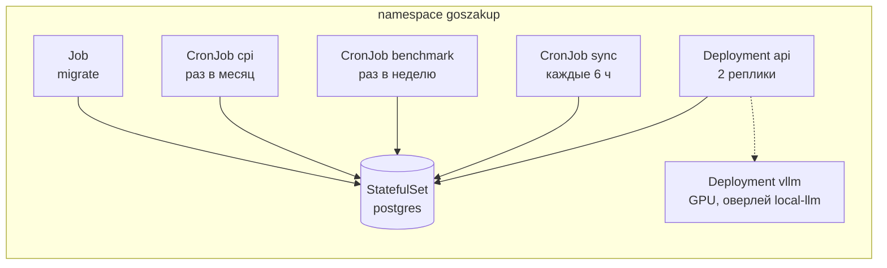

# Архитектура

Система отвечает на вопросы о государственных закупках 27 организаций за 2024–2026 годы по данным OWS v3 портала goszakup.gov.kz. Она загружает и нормализует данные, строит аналитические витрины и через AI-агента формирует проверяемые ответы на русском и казахском языках.

Главный принцип: **LLM не выполняет расчёты.** Числа считают SQL-витрины и Python-функции. Модель только разбирает вопрос и формулирует вывод по готовым фактам, а каждое число в её тексте сверяется с результатами инструментов.

## Компоненты

| Компонент | Назначение |
|---|---|
| `ows` | клиент OWS v3: GraphQL и REST, курсорная пагинация, повторы с нарастающей паузой, ограничение частоты, защита токена |
| `ingestion` | загрузка по 27 БИН, инкремент по `indexDate`, догрузка связанных записей, выборка цен по всему порталу |
| `transform` | очистка названий, приведение единиц измерения |
| `semantic` | эмбеддинги описаний товаров (multilingual-e5-small, ONNX на CPU) и подклассы внутри кода ЕНС ТРУ |
| `marts` | материализованные представления: наблюдения цен, эталонные цены, аномалии, эффективность |
| `quality` | 17 проверок качества данных, результаты влияют на раздел «Уверенность» ответа |
| `analytics` | Fair Price, аномалии цен и объёмов, ряд ИПЦ, робастная статистика |
| `agent` | граф LangGraph, инструменты, подсказки, проверка цифр, память диалогов |
| `evals` | эталонный набор вопросов и метрики точности |
| `api` | FastAPI: вопросы агенту (обычный и потоковый ответ), вход и личные диалоги, аналитика без LLM, статус данных |
| `ui/` | Streamlit-клиент к API: чат, Fair Price, аномалии, эффективность, статус данных; отдельный образ, к базе и ключам доступа нет |

## Поток данных

1. **Загрузка.** По каждому из 27 БИН через GraphQL выгружаются пункты плана (с местами поставки и ЕНС ТРУ), договоры (с позициями, поставщиком и заказчиком), лоты и объявления. Справочники берутся через REST. Ответы сохраняются как есть в `raw.ows_object`, затем раскладываются по таблицам `core`.
2. **Догрузка связей.** Записи, на которые ссылаются загруженные данные, но которые не попали в выборку (лоты из позиций договоров, пункты плана, объявления), запрашиваются по id.
3. **Выборка цен по порталу.** Для ~1 870 кодов ЕНС ТРУ, покрывающих 95% затрат 27 организаций на товары, загружаются договоры всех заказчиков РК, до 200 на код и год.
4. **Инкремент.** `meta.sync_state` хранит последнюю метку индексации по каждой сущности и БИН. Следующий запуск запрашивает только записи с `indexDate` новее неё. Журнал `/v3/journal` не используется: в нём около 5 млн изменений в сутки по всему порталу без фильтра по БИН.
5. **Подклассы товаров.** Для новых описаний из пунктов плана считаются эмбеддинги (`core.item_text`), затем описания каждого затронутого кода ЕНС ТРУ группируются в подклассы (`core.item_subclass`). Ошибка этого шага не останавливает синхронизацию: витрины используют прежние подклассы.
6. **Витрины и проверки.** После загрузки обновляются витрины `mart` и запускаются проверки качества. Если SQL витрины в коде изменился (хэш хранится в комментарии к представлению), витрины пересобираются; то же делает `db migrate` до старта API.

Требование ТЗ о задержке не более 24 часов закрывается синхронизацией каждые 6 часов (worker в compose или CronJob в Kubernetes) и проверкой `sync_older_than_24h`.

## AI-агент

| Узел | Что делает | LLM |
|---|---|---|
| `understand` | определяет язык (RU/KZ), тип вопроса и упомянутые сущности; в подсказке список 27 организаций и последние 3 вопроса диалога | да |
| `resolve` | проверяет БИН, находит коды ЕНС ТРУ по названию товара (нечёткий поиск по каталогу из 10 тыс. названий), регион по КАТО, период | нет |
| `check` | при нехватке данных задаёт уточняющий вопрос: нет номера лота (с подсказкой подходящих лотов), не найден товар, вопрос не о закупках | нет |
| `tools` | вызывает инструменты по типу вопроса | нет |
| `compose` | пишет краткий вывод (1–3 предложения) и 2–5 пунктов аналитики только по таблице фактов | да |
| `verify` | сверяет каждое число в тексте с результатами инструментов; при расхождении один повтор с подсказкой | нет |
| `remember` | сохраняет вопрос и параметры в память диалога | нет |

**Типы вопросов и инструменты:**

| Тип вопроса (ТЗ) | Инструмент |
|---|---|
| поиск | `search` — договоры по фильтрам, количество, сумма, Top-K |
| сравнение | `compare` — агрегаты по заказчикам, годам, регионам, поставщикам, способам закупки |
| аналитика | `efficiency` и `compare` — экономия, доля из одного источника, несостоявшиеся лоты, концентрация поставщиков |
| выявление аномалий | `price_anomaly` — отклонение от средневзвешенной по ЕНС ТРУ; `volume_anomaly` — рост количества к прошлым годам |
| справедливость цены | `fair_price` — Fair Price лота |

Инструмент выбирается по типу вопроса детерминированно, без выбора моделью. Поэтому один и тот же вопрос на тех же данных всегда даёт те же цифры.

**Структура ответа** соответствует ТЗ: краткий вывод; использованные данные (период, БИН, фильтры, дата актуальности); сравнение и аналитика с ключевыми показателями; метод оценки; уверенность и ограничения (размер выборки, проверки качества данных, число подтверждённых цифр); Top-K со ссылками на договоры и объявления на портале.

**Воспроизводимость.** Каждый ответ сохраняется в `meta.analysis_run`: вопрос, распознанные параметры, вызовы инструментов с аргументами и результатами, текст ответа, проверка цифр, модель, версия подсказок, время по узлам и токены. Ответ открывается повторно по `run_id` через `GET /api/runs/{id}`.

**Память и сессии.** Состояние графа сохраняет checkpointer LangGraph в схеме `agent` PostgreSQL, диалог идентифицируется `thread_id`. Агент понимает уточнения («а за 2024?», «а у этой организации?», номер лота после просьбы его назвать).

**Устойчивость.** Можно задать резервного провайдера LLM (`LLM_FALLBACK_PROVIDER`). Если LLM недоступна на этапе ответа, вывод собирается шаблоном из тех же фактов с пометкой в ограничениях.

## Развёртывание

**Docker Compose:**

| Сервис | Назначение |
|---|---|
| `postgres` | PostgreSQL 17 + pgvector |
| `migrate` | одноразовый: миграции Alembic и создание пользователя API |
| `worker` | при пустой базе — первичная загрузка, затем синхронизация каждые 6 часов и выборка цен раз в неделю |
| `api` | FastAPI и агент |
| `ui` | опционально, профиль `ui`: веб-интерфейс на порту 8501 |
| `vllm` | опционально, профиль `local-llm`: локальная модель с OpenAI-совместимым API |

**Kubernetes** (`deploy/k8s`, kustomize):

Манифесты проверены kubeconform по схемам Kubernetes 1.31.

**LLM внутри контура.** Агент работает с любым сервером с OpenAI-совместимым API: OpenAI, vLLM, Ollama, LiteLLM. Переключение — через `OPENAI_BASE_URL` и `OPENAI_MODEL`, без изменения кода. Проверено на корпоративной Qwen3-8B: 99% точности фактов (см. [examples.md](examples.md) и `evals/reports`).

## Безопасность

- **Токен OWS** передаётся только в заголовке `Authorization` и только на хост OWS (клиент отказывается отправлять его на чужой хост из ссылки следующей страницы); в логи и тексты ошибок он не попадает.
- **Секреты** хранятся в `.env` (исключён из git) или в Secret Kubernetes; история git проверена на отсутствие ключей.
- **Минимальные права:**
  - роль `goszakup_api` читает `core`, `mart` и `meta`, а пишет только в журнал ответов и память агента;
  - к `raw` и записи в данные доступа у неё нет;
  - права на пересоздаваемые витрины выдаются автоматически.
- **Разделение секретов по сервисам:** токен OWS есть только у загрузки, ключи LLM — только у API.
- **NetworkPolicy** в Kubernetes пускает к Postgres только поды приложения.
- **SQL** строится из фиксированных фрагментов с параметрами, текст модели в запросы не попадает.
- **Входные данные:** длина вопроса ограничена, вопросы не о закупках отклоняются, инструменты только читают данные.

## Наблюдаемость

- `meta.sync_run` — журнал загрузок: команда, время, статус, статистика, ошибка. На время загрузки она держит advisory-блокировку Postgres. Новая загрузка помечает как `interrupted` записи, чья блокировка уже не удерживается (процесс остановлен). Записи живых процессов не трогаются.
- `meta.sync_state` — точки инкремента по сущностям.
- `meta.gap_miss` — связанные записи, которых нет в API (исчезнувшие версии пунктов плана и т. п.). Догрузка не запрашивает их повторно в течение 7 дней.
- `meta.dq_check_result` — история проверок качества.
- `meta.analysis_run` — ответы агента со временем по узлам графа, токенами, версией подсказок и проверкой цифр.
- `GET /api/status` — дата актуальности данных, идущие сейчас загрузки и последние проверки качества.

## Выбор технологий

| Технология | Почему |
|---|---|
| PostgreSQL | объём — сотни тысяч строк, нужны транзакции, оконные функции и материализованные представления; ClickHouse избыточен |
| pgvector | эмбеддинги описаний рядом с данными, без отдельной векторной базы; сходство аналогов (`<=>`) считается в том же запросе, что и выборка цен |
| pg_trgm | нечёткий поиск кода ЕНС ТРУ по названию товара в вопросе |
| multilingual-e5-small (int8, ONNX Runtime) | 118 МБ, CPU, русский и казахский, лицензия MIT; модель зашита в образ с проверкой sha256, интернет на площадке не нужен; без torch |
| GraphQL OWS | вложенные данные (договор → позиции → пункт плана → место поставки) одним запросом и фильтры по датам; REST только для справочников |
| SQLAlchemy 2, Alembic | асинхронный доступ, версионированные миграции |
| LangGraph | явный граф с условными переходами, повтором проверки и checkpointer для памяти |
| FastAPI | асинхронный API, автоматическая документация OpenAPI |
| numpy, scikit-learn | робастная статистика, Isolation Forest для аномалий объёмов, иерархическая кластеризация описаний |
| uv | фиксированные версии всех зависимостей (`uv.lock`), быстрая сборка образа |
| Docker, Kubernetes | развёртывание on-prem; секреты и права разделены по сервисам |

## Производительность

| Операция | Время |
|---|---|
| первичная загрузка 27 организаций | ~10 мин |
| выборка цен по порталу (~1 870 кодов) | ~50 мин |
| инкрементальная синхронизация | 1–3 мин |
| эмбеддинги всех описаний (~173 тыс.), первый раз | ~8 мин; дальше — только новые, секунды |
| сборка всех витрин | ~1,5 мин |
| ответ агента (gpt-5.4-mini, p50 / p95) | 3,6 / 5,4 с |
| ответ без LLM (`/api/fair-price`) | десятки миллисекунд |
