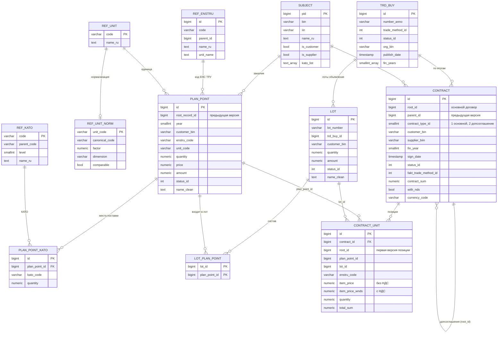

# Схема хранения

Хранилище — PostgreSQL 17 с расширениями `pgvector` и `pg_trgm`. Схема версионируется миграциями Alembic (`backend/migrations`), витрины пересобираются командой `goszakup marts build`.

## Слои

| Схема | Назначение | Как наполняется |
|---|---|---|
| `raw` | ответы OWS v3 как есть (JSONB) с хешем и меткой индексации | загрузка; основа для пересборки `core` без повторной выгрузки (`goszakup ingest replay`) |
| `core` | нормализованная модель: план, лоты, объявления, договоры, участники, справочники | маппинг из `raw` при загрузке |
| `mart` | витрины для аналитики и агента (материализованные представления) | `goszakup marts build / refresh` |
| `meta` | состояние синхронизации, проверки качества, журнал ответов агента, список 27 БИН | загрузка, проверки, агент |
| `agent` | память диалогов (checkpointer LangGraph) | агент |

Объёмы на 15.10.2026: `raw` — 490 тыс. объектов; `core` — 225 тыс. пунктов плана, 194 тыс. лотов, 42 тыс. объявлений, 195 тыс. договоров, 332 тыс. позиций договоров, 44 тыс. участников; `mart.price_observation` — 288 тыс. наблюдений цен (79 тыс. по 27 организациям и 209 тыс. по другим заказчикам РК).

## Сущности OWS и таблицы

ТЗ требует охватить объявления, план, договоры, лоты, вид предмета закупки, заказчиков, поставщиков, статусы и справочники.

| Сущность ТЗ | Источник OWS v3 | Таблица | Зачем |
|---|---|---|---|
| План | GraphQL `Plans` | `core.plan_point`, `core.plan_point_kato` | код ЕНС ТРУ, единица измерения, плановая цена и количество, место поставки (КАТО); база для объёмов и экономии |
| Объявления | GraphQL `TrdBuy` | `core.trd_buy` | способ закупки, статус, даты публикации и итогов, организатор |
| Лоты | GraphQL `Lots` | `core.lot`, `core.lot_plan_point` | номер лота для вопросов «справедливость цены лота №…», статус (несостоявшиеся), связь с пунктами плана |
| Договоры | GraphQL `Contract` + `ContractUnits` | `core.contract`, `core.contract_unit` | фактические цены за единицу без НДС и с НДС, количество, версии допсоглашений |
| Заказчики и поставщики | GraphQL `Subjects`, вложенные `Supplier` и `Customer` | `core.subject` | названия, БИН/ИИН, признаки (малый бизнес, квазигоссектор), КАТО |
| Вид предмета закупки | `ref_subject_type` (товар, работа, услуга) | `core.ref_dict` | цена за единицу сопоставима только для товаров |
| Статусы | `ref_buy_status`, `ref_lots_status`, `ref_contract_status`, `ref_pln_point_status` | `core.ref_dict` | отбор актуальных версий, несостоявшиеся лоты, расторжения |
| Способы закупки | `ref_trade_methods` | `core.ref_dict` | доля закупок из одного источника |
| Единицы измерения | `ref_units` | `core.ref_unit`, `core.ref_unit_norm` | нормализация цен к общей единице |
| Территории | `ref_kato` | `core.ref_kato` | регион и город поставки |
| ЕНС ТРУ | вложенный `PlnPoint.RefEnstru` (в REST справочник недоступен) | `core.ref_enstru` | названия, иерархия, стандартная единица |
| ИПЦ | Бюро национальной статистики, Taldau | `core.ref_cpi` | поправка цен на инфляцию |
| Подклассы товаров | производные от `PlnPoint.extraDescRu` | `core.item_text`, `core.item_subclass` | эмбеддинги описаний и группы похожих описаний внутри кода ЕНС ТРУ для Fair Price и аномалий цен |

Не загружаются: заявки участников (`TrdApp`), акты, казначейские платежи, накладные, реестр недобросовестных поставщиков. Для вопросов ТЗ они не нужны, их можно добавить тем же механизмом.

## Модель `core`

**Ключи и ограничения.** Первичные ключи — идентификаторы OWS. Внешние ключи заданы только внутри агрегатов, которые приходят одним ответом API (место поставки → пункт плана, позиция → договор, связь лот → пункт плана). Ссылки между сущностями из разных запросов (позиция → пункт плана, лот → объявление) внешними ключами не ограничены: при частичной выгрузке загрузка не должна падать. Их полноту контролируют проверки качества и догрузка связей.

**Деньги** хранятся как `numeric(20,4)`, даты портала — как локальное время Казахстана без часового пояса, служебные метки (`fetched_at`, `started_at`) — с часовым поясом.

## Версии записей

**Договоры.** Допсоглашение — это новая запись договора (`contract_type_id = 2`) с полным набором позиций. `root_id` указывает на основной договор, `parent_id` — на предыдущую версию; старая версия получает статус «Изменен». Витрина `mart.contract_current` берёт последнюю неудалённую версию в цепочке. Без этого суммы считались бы дважды.

**Позиции договоров.** Позиция каждой версии ссылается на свою первую версию через `root_id`.

**Пункты плана.** При изменении плана появляется новая версия (`root_record_id` указывает на предыдущую), а старая исчезает из API. Поэтому около 10% позиций договоров ссылаются на пункты плана, которых в API уже нет. Витрина восстанавливает ссылку по цепочке:

| Шаг | Как ищется пункт плана | Доля позиций 27 организаций |
|---|---|---|
| 1 | прямая ссылка `plan_point_id` | 88,6% |
| 2 | новая версия пункта (`root_record_id`) | 1,4% |
| 3 | пункт плана того же лота с тем же кодом ЕНС ТРУ | 0,4% |
| 4 | пункт плана того же заказчика с тем же кодом ЕНС ТРУ (сначала того же года) | 7,8% |
| 5 | только единица: самая частая для кода ЕНС ТРУ | 1,3% |
| — | не восстановлено | 0,6% |

Способ восстановления записан в `price_observation.plan_link` и учитывается в уверенности ответа. Эталонные цены строятся только по шагам 1–4.

## Инкрементальное обновление

`meta.sync_state` хранит по каждой паре «сущность × область» (БИН, БИН:год, код ЕНС ТРУ:год) максимальную метку `indexDate` из загруженных записей и время последнего успеха. Следующий запуск передаёт в GraphQL фильтр `indexDate ≥` этой метки с точностью до секунды. Повторная запись идемпотентна (`INSERT … ON CONFLICT DO UPDATE`), поэтому пересечение на границе безопасно.

## Витрины `mart`

| Витрина | Зерно | Назначение |
|---|---|---|
| `contract_current` | цепочка договоров | актуальная версия договора |
| `price_observation` | позиция актуального договора | цена без НДС за нормализованную единицу, регион и город, ссылки на портал, способ восстановления пункта плана, ключ описания и подкласс товара; основа всей ценовой аналитики |
| `price_benchmark` | ЕНС ТРУ × единица × год × регион | средневзвешенная, медиана, квартили |
| `price_anomaly` | позиция договора 27 организаций | отклонение от средневзвешенной по подклассу или по всему коду ЕНС ТРУ (`peer_group`), robust z-score, оценка переплаты |
| `volume_yearly` | заказчик × ЕНС ТРУ × год | плановые и фактические количества и суммы |
| `volume_anomaly` | заказчик × ЕНС ТРУ × год | рост количества к прошлым годам и к другим заказчикам |
| `procurement_efficiency` | заказчик × год | экономия, доля из одного источника, несостоявшиеся лоты, HHI, сроки |
| `customer_coverage` | заказчик × год | число договоров и изменение к прошлому году (контроль полноты) |
| `cpi_index` | месяц | накопленный индекс потребительских цен |
| `region_price_index` | регион | региональный коэффициент цен |
| `season_index` | месяц | сезонный коэффициент цен |
| `enstru_unit` | код ЕНС ТРУ | самая частая единица измерения |
| `item_catalog` | код ЕНС ТРУ × название | нечёткий поиск кода по названию товара (индекс `gin_trgm_ops`) |

## Служебные таблицы `meta`

| Таблица | Содержимое |
|---|---|
| `scope_bin` | 27 организаций выборки |
| `sync_run` | журнал загрузок: команда, время, статус, статистика, ошибка |
| `sync_state` | точки инкремента |
| `gap_miss` | связанные записи, которых нет в API; повторно запрашиваются не чаще раза в 7 дней |
| `app_user` | пользователи API и веб-интерфейса: логин, scrypt-хеш пароля, признак активности |
| `agent_thread` | владелец, заголовок и время диалога; роль API может читать, создавать и обновлять записи |
| `dq_check_result` | результаты проверок качества с примерами id |
| `analysis_run` | ответы агента: параметры, вызовы инструментов, ответ, проверка цифр, модель, токены, время по узлам, версия подсказок, `thread_id` |

## Подклассы товаров

Под одним кодом ЕНС ТРУ встречаются товары разного класса, а название и характеристика из справочника у них одинаковые. Различает их только дополнительное описание заказчика в пункте плана (`extra_desc_ru`), которое заполнено у 93% позиций.

| Таблица | Ключ | Содержимое |
|---|---|---|
| `core.item_text` | `text_key` = md5 нормализованного описания | текст (нижний регистр, сжатые пробелы, первые 200 символов), модель, эмбеддинг `vector(384)` |
| `core.item_subclass` | код ЕНС ТРУ × `text_key` | номер подкласса внутри кода (0 — самый крупный), подпись подкласса (самое частое описание), модель |

Описания, совпадающие с названием кода, в подклассы не попадают. Подкласс присваивается позиции договора только при надёжной связи с пунктом плана (прямая, версия, лот). При смене модели все описания пересчитываются автоматически: в обеих таблицах хранится идентификатор модели.
